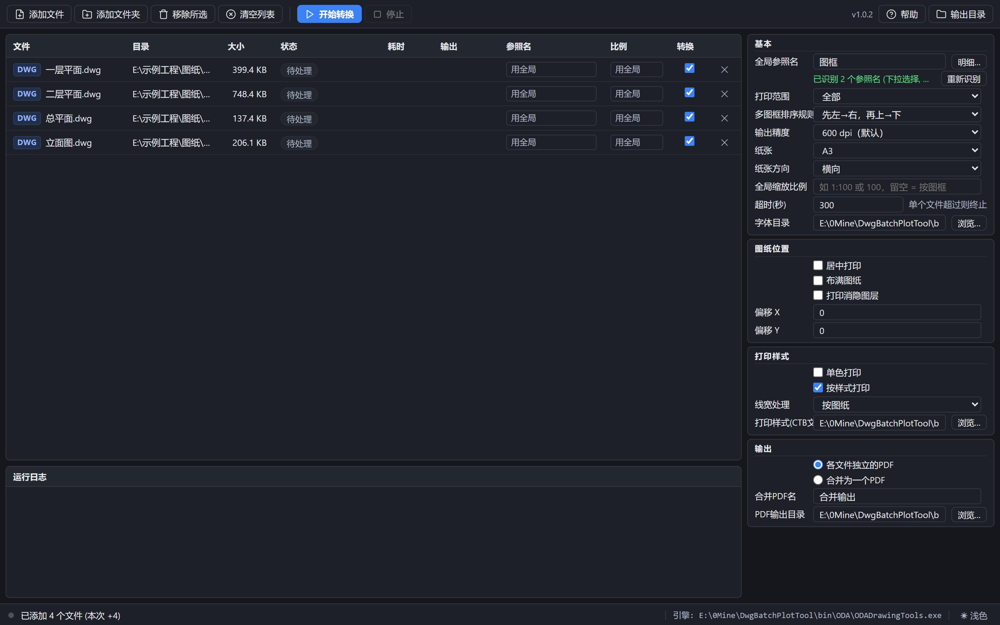

# DwgBatchPlotTool — DWG/DXF 批量转 PDF

从某 CAD 工程的 ODA 绘图功能中提取出来的独立批量转换工具，界面是 **HTML**（浏览器渲染）。

当前版本：**1.0.2**（版本号在 `src\DwgBatchPlotTool\DwgBatchPlotTool.csproj` 与 `src\ODADrawingTools\ODADrawingTools.csproj` 的 `<Version>` 里，界面与帮助页显示的就是它）

本程序开源免费使用，严禁转卖，否则生儿子没屁眼。

* 引擎：ODA/Teigha 4.02 (`ODA\ODADrawingTools.exe`)，带 `--plot` / `--plot-batch` / `--plot-merge` / `--merge-list` / `--list-refs` 等模式
* 界面：**HTML 页面 + 本机 HTTP 接口**（`src\DwgBatchPlotTool\ui\index.html` 编译进 exe），**附加体积 0** —— 不带 Qt/MFC/WebView2，不装任何 NuGet 包，也不带 .NET Framework（系统自带）。程序启动后用 Edge/Chrome 的 `--app` 模式开一个无地址栏的独立窗口
* 界面按开源桌面工具的惯例做：工具条图标按钮、紧凑数据表格（文件类型标签 + 状态徽章）、空状态插画、底部状态栏（进度条 / 统计 / 引擎路径 / 主题开关）；配色走一套 CSS 令牌，浅色与深色主题共用同一套语义名
* 转换在子进程中完成：单个文件损坏只会让该文件失败并被单独标记，不会拖垮整批，更不会带崩界面
* 许可：**MIT**（`ODA\` 运行库、`Fonts\` 字体等第三方组件除外，见文末「许可协议」）



<p align="center"><i>深色主题下的主界面：左侧文件列表，右侧参数面板，底部运行日志与状态栏</i></p>

---

## 目录结构

```
DwgBatchPlotTool\
├─ bin\                       构建产物（**整个目录可直接拷走运行**）
│  ├─ DwgBatchPlotTool.exe   主程序（bin\ 是唯一的编译输出目录）
│  ├─ settings.ini           参数（界面自动保存，跟着 exe 走）
│  ├─ ODA\                   构建时从 ..\ODA\ 复制：引擎 + Teigha 运行库
│  ├─ Fonts\                 构建时从 ..\Fonts\ 复制：字体
│  └─ PlotStyles\            构建时从 ..\PlotStyles\ 复制：打印样式表
├─ build.bat                 一键构建（引擎 + 界面 + 自检）
├─ DwgBatchPlotTool.sln      Visual Studio 解决方案
├─ .gitignore                忽略构建产物与输出目录
├─ README.md                 本文件
├─ LICENSE                   MIT 许可（第三方运行库除外，见「许可协议」）
├─ docs\                     文档配图
│  ├─ screenshot.png         README 里的界面截图
│  └─ shoot.py               重新生成截图的脚本（Edge 无头 + Playwright）
├─ src\                       源码（一个项目一个子目录）
│  ├─ DwgBatchPlotTool\       界面程序
│  │  ├─ Program.cs           入口
│  │  ├─ HtmlHost.cs          界面宿主：本机 HTTP 服务 + JSON 接口 + 原生对话框线程
│  │  ├─ BatchRunner.cs       批量转换核心（无 UI 依赖，可被自检调用）
│  │  ├─ OdaRunner.cs         引擎子进程调用（命令行转义 / 超时 / 取消）
│  │  ├─ PlotOptions.cs       参数 → 引擎命令行翻译
│  │  ├─ RefScan.cs           后台扫描已加入图纸的参照名（喂给下拉框）
│  │  ├─ Settings.cs          参数持久化 (settings.ini)
│  │  └─ ui\                  界面资源，全部编译进 exe
│  │     ├─ index.html        界面页面
│  │     ├─ help.html         使用帮助（「帮助」按钮弹出）
│  │     ├─ app.js            页面逻辑（轮询状态、提交参数）
│  │     ├─ style.css         样式
│  │     └─ icon.svg          图标源文件
│  └─ ODADrawingTools\        引擎程序
│     ├─ Program.cs           ODA 出图引擎主程序（DXF/DWG→PDF）
│     ├─ DwgDxfConverter.cs   DXF↔DWG 互转
│     └─ ODADrawingTools.csproj 构建后输出到 ..\..\ODA\
├─ ODA\                      ODA 运行时（必需，勿删）
│  ├─ ODADrawingTools.exe    转换引擎（由 src\ODADrawingTools\ 构建）
│  └─ *.dll                  Teigha/ODA 原生库
├─ Fonts\                    随工程附带的 SHX/中文字体（可裁剪，见下）
├─ PlotStyles\               打印样式表（monochrome.ctb / .stb）
├─ tests\Selftest\           自检程序（本地保留，不随仓库发布）
├─ icon.png / icon.ico       程序图标（SVG 源文件在 src\DwgBatchPlotTool\ui\icon.svg）
└─ output\                   默认输出目录（可改）
```

代码与产物分开：源码在 `src\<项目名>\`（界面、引擎各一个项目），编译产物只有 `bin\`（界面）和 `ODA\`（引擎 exe + ODA 运行时）。`tests\` 是作者本地用的自检程序，已被 `.gitignore` 排除，不在仓库里。

**三个路径只认 exe 所在目录**（把 `bin\` 整个拷到哪都行，程序不会去上一级目录找东西）：

| 界面项 | 默认值 | 说明 |
|---|---|---|
| CTB文件 | `<程序目录>\PlotStyles\monochrome.ctb` | 打印样式表 |
| 输出目录 | `<程序目录>\output` | 输出 PDF 的地方 |
| 字体目录 | `<程序目录>\Fonts` | 非系统字体（方正/华文/THFont 等），缺了会掉字或乱码 |

这三个是**默认值**，不写进 `settings.ini`；**你在界面上改成别的路径后才保存**，之后一直用你改的值。
（若存下来的路径已经不存在，比如程序被挪走了，会自动回落到默认位置。）
表里的 `<程序目录>` = `DwgBatchPlotTool.exe` 所在目录，也就是 `bin\`；**`ODA\` 必须在同一层**，
程序不会去上层目录里找引擎 —— 只把 exe 单独拷出来会提示「未找到 ODA 引擎」。

## 支持的图纸版本

引擎用的是 ODA/Teigha **4.02.2**（`ODA\TD_Mgd_4.02_11.dll`），这个版本认得的最新格式是 **AC1027（AutoCAD 2013）**：

| | 范围 | 实测 |
|---|---|---|
| DWG | R12 (AC1009) ~ 2013 (AC1027) | R14 (AC1014)、2000 (AC1015)、2004 (AC1018) 三种实图出图正常 |
| DXF | R12 ~ 2013 (AC1027)，实测都是 ASCII DXF | R12 ASCII、2013 ASCII 出图正常（2013 的 DXF 由引擎 `--convert` 从 DWG 转出后回读验证） |
| 不支持 | 2018 及以上（AC1032） | 缺这块格式支持：运行库的 `DwgVersion` 枚举最大只到 `AC1027`，打开 2018 版图纸会报 `ERROR: eInvalidFileVersion` |

* 判定看的是**文件内容里的版本号**，不是扩展名 —— 把 2018 版 DWG 改名成 `.dxf` 也照样打不开。
* 高于 2013 的图纸，用 CAD 另存为 2013 或更低版本即可；要长期支持 2018+，需要整目录替换 `ODA\` 为新版 ODA 运行库，并按新版 API 重编 `src\ODADrawingTools\`（出图 API 在这几版之间基本没变）。
* 输出只有 **PDF**（矢量），不写 DWG/DXF。

## 使用

1. 运行 `bin\DwgBatchPlotTool.exe` —— 弹出 Edge/Chrome 的独立窗口（无地址栏），关掉窗口即退出程序
2. **添加文件** / **添加文件夹**（弹的是系统原生对话框，能拿到真实路径），列表只接受 `.dwg` `.dxf`
3. 右侧设置打印参数（详见下表），下方选择输出方式
4. **开始转换**；进度条与底部日志实时显示每个文件的结果

列表每行有两列操作：**转换**（勾选框，加入的文件默认都勾上，取消勾选的这次不转）和 **✕**（把这行从列表里去掉）。
勾选状态只影响本次转换，不影响文件本身。

**使用帮助**：工具栏右侧的 **「帮助」** 按钮弹出一份完整说明（快速上手、界面分区图、工作流程图、文件列表各列、参数速查、参照名分页打印示意图、纸张与方向、常见问题、无界面用法）。全部插图是内嵌 SVG，跟着界面深/浅色主题一起变色，不带任何外部图片。内容在 `src\DwgBatchPlotTool\ui\help.html`，编译进 exe，按需从 `help.html` 路由拉取。

参数会记在与 `DwgBatchPlotTool.exe` 同目录的 `settings.ini`（即 `bin\settings.ini`），下次打开自动恢复。

**深浅色主题**：默认跟随 Windows 的应用主题；点右下角状态栏的 `☾ 暗色 / ☀ 浅色` 随时切换，选择会记进 `settings.ini`（`theme=light|dark`）。

### 无界面 / 脚本用法

```bat
bin\DwgBatchPlotTool.exe --no-browser
```

只启动本机服务，并把界面地址打到标准输出（`URL: http://127.0.0.1:17845/t/<token>/index.html`），
可以自己用浏览器打开，也方便脚本调用。页面接口（都是 POST + JSON）：

| 接口 | 作用 |
|---|---|
| `api/state` | 取文件列表 / 进度 / 日志 / 参数（GET） |
| `api/add` | `{"paths":[...]}` 或 `{"dir":"...","recursive":true}` |
| `api/remove` / `api/clear` | 移除指定文件 / 清空 |
| `api/check` | `{"path":"...","checked":false}` 勾选/取消勾选（决定这个文件是否参与转换） |
| `api/set-ref` | `{"path":"...","refName":"Layout*_1"}` 给单个文件指定参照名（空串 = 用全局参照名） |
| `api/set-scale` | `{"path":"...","scale":"1:100"}` 给单个文件指定比例（空串 = 用全局比例；格式错返回 `ok:false`） |
| `api/rescan` | 重新扫描已加入图纸的参照名（刷新下拉候选） |
| `api/start` | `{"options":{...}}` 开始转换（不传 `options` 就用已保存的设置） |
| `api/cancel` | 停止 |
| `api/save-settings` | `{"options":{...}}` 只存参数 |
| `api/pick-files` / `api/pick-folder` / `api/pick-ctb` | 弹系统原生对话框 |
| `api/open-dir` | `{"dir":"..."}` 打开输出目录 |
| `api/open-file` | `{"path":"..."}` 打开输出文件（列表里点输出列即调用它） |
| `api/quit` | 退出程序 |

地址带随机 token，只能本机访问，防止别的程序误调。页面每 5 秒 ping 一次；关掉浏览器窗口 3 秒后程序自动退出。

**参数随时自动保存**：右侧任何参数一改动（防抖 0.4 秒）就写进 `settings.ini`，所以无论用哪种方式退出程序（直接关窗口、被强杀），设置都已经保存好了，下次启动自动恢复。关窗口即退出程序。

**环境变量**：`DWGBP_ROOT` 指定程序目录（找 `ODA\` `Fonts\` `PlotStyles\` 用，默认 exe 同目录，自检程序靠它指向项目根）；`DWGBP_SETTINGS` 指定设置文件路径（默认是与 `DwgBatchPlotTool.exe` 同目录的 `settings.ini`，自检就是用它指向临时文件，免得动你的设置）。

### 界面参数

| 分组 | 参数 | 说明 |
|---|---|---|
| 基本 | 全局参照名 | **默认 `图框`**。**对所有文件生效**的默认参照名。可编辑的下拉框：点箭头从**已加入的 dwg/dxf** 里汇总出的参照名里选（块名 + **外部参照的文件名**），也能直接手打。留空 = 整张图。旁边的「明细…」按钮看明细（实例数/空间/尺寸，外部参照带紫色标签）。单个文件要不同的参照名，在**列表的「参照名」列**里单独填 |
| | 空间 | 仅模型空间 / 仅布局空间 / 全部 |
| | 纸张 | **默认 A3**；另有「按图框(A3)」= 不传 `--paper`（纸张按命中的图框长宽比出，长边 420mm）、A4/A3/A2/A1/A0、自定义宽高(mm)。选「自定义」时下面才出现宽/高输入框。**页面的实际大小 = 布局里的规范纸张**，引擎会自动把布局纸张改成你选的纸张；页面上四周留白是打印设备自带的页边距（约 7.5/20mm），图框内容会铺满可打印区 |
| | 线宽 | 默认 / 按比例缩放 / 不打印线宽 |
| | 超时(秒) | 单个文件的超时上限，超时后杀掉引擎子进程 |
| | 字体目录 | **默认 `<程序目录>\Fonts`**。非系统字体（方正/华文/THFont 等 SHX、TTF）所在文件夹，缺了会掉字或乱码。可以改成别的目录（多个用 `;` 分隔），改完立即生效 |
| 图纸位置 | 居中 / 布满图纸 | 打印位置 |
| | 比例 | 打印比例。可写 `1:100`、`1/100`、`1-100`，也可只写分母 `100`（= 1:100）。**留空 = 按图框**：把命中的图框缩放到纸张大小，比例由图框尺寸算出来。填错格式会直接报错，不会被悄悄忽略 |
| | 偏移X / 偏移Y | 打印偏移 (mm) |
| | 打印消隐对象 | 是否打印消隐对象 |
| | 方向 | 横向 / 纵向 |
| | 多图框排序规则 | 一个文件里有多个图框时的出图页序：`先左→右，再上→下`（默认，逐行）/ `先左→右，再下→上` / `先上→下，再左→右`（逐列）/ `先下→上，再左→右`。按左下角坐标排，同一行/列按半张图框取整，摆得不那么齐也算一行。全局设置，对所有文件生效 |
| | 输出精度 | 曲线细分、嵌入图片与渐变填充的分辨率，单位 dpi：`300` / `600`（默认） / `900` / `1200` / `1800` / `2400` / `3600`；曲线细分、嵌入图片、渐变填充三类参数都取同一个值。线条与文字始终是矢量，不受这一项影响；图纸里没有光栅图片或渐变填充时，调高只是文件更大 |
| 打印样式 | 单色打印 | `--mono` |
| | 按 CTB/STB 样式打印 | 默认勾选；**CTB文件**默认指向 `PlotStyles\monochrome.ctb` |
| 输出 | 每个文件一个 PDF | 输出 `原名.pdf`（按源目录结构建子目录，见下一行）；重名自动变成 `原名 (2).pdf` |
| | 合并为一个 PDF | 先各自出图，再合并成一个 PDF（文件名见「合并文件名」） |
| | 添加文件夹 | 递归收集所有子目录里的 dwg/dxf |
| | 输出目录结构 | 选「每个文件一个 PDF」时，按源图纸相对**添加时的文件夹**的路径建子目录存放（`主目录\子目录\原名.pdf`）；单个添加的文件平铺在输出目录。选「合并为一个 PDF」时只有一个文件，不分子目录 |
| | 开始转换 | 工具栏上的主按钮；转换只在点它后才开始（旁边的「停止」可中断） |

### 按参照图框分页打印（一个文件多个图框）

「参照名」就是图纸里放图框的**块名 / 外部参照名**。填上之后：

* 引擎在模型空间和各个图纸空间里找出**所有名字匹配的块参照**，用每个实例自己的几何范围（外扩 1 mm）当打印窗口；
* **每个实例出一页** —— 所以一个文件里有 22 个图框，就得到 22 页 PDF；
* 名字支持 `*` `?` 通配（例如 `Layout*_1` 一次匹配 22 个图框）；
* 参照名留空 = 不按图框过滤，按整张图打印；
* 命中的图框尺寸会决定纸张比例，除非你又显式指定了纸张。

**参照名 / 比例可以逐个文件指定**：列表里有「参照名」和「比例」两列，填了就用这个文件自己的值；留空（显示「用全局」）就用右侧的全局值。比例格式与全局一致，填错会弹出提示并回退。
所以一张图纸里画了不同型号的图框时，可以给每个文件填各自的图框名。

不知道该填什么名字，两种办法：

* **点输入框右边的下拉箭头** —— 程序已经把已加入的 dwg/dxf 都扫过一遍，参照名汇总在这个下拉列表里，直接选（列表是后台线程扫的，第一次点可能要先等一两秒；扫完下拉框会自己刷新）。下拉框可以直接打字，支持 `*` `?` 通配。
* **点「明细…」按钮** —— 在输入框下面展开明细表（参照名 / 所在图纸 / 实例数 / 所在空间 / 尺寸），可以输入关键字过滤，点一行即回填到输入框。

输入框下面有一行小字说明当前状态：**正在识别参照名…** / **已识别 N 个参照名** / **这些图纸里没识别到参照名, 可直接手动输入** / **识别失败: <原因>**（原因也会写进运行日志）。
旁边的 **「重新识别」** 按钮可以强制重新扫一遍已加入的图纸（比如换了图纸、或怀疑扫描没跑完）。

转换完成后，列表的状态列会显示 **「成功 (N 页)」**，N = 这一文件实际出的页数（= 命中的图框数）。

### 外部参照（被参照的 dwg/dxf）也能当参照名用

图纸里常见的做法是：图框放在一个单独的 `图框_Ref.dwg` 里，主图用**外部参照**（XREF）把它插进来。
这种图的块参照名（AutoCAD 里看到的 `块参照_1` 之类）只是自动生成的，**没有意义**，有意义的是被参照的那个文件名。

程序会把这两种都列进下拉框：

* 块名（`块参照_1`）—— 照旧能用，填上就按这个块名分页；
* **外部参照的文件名**（`图框_Ref.dwg`）—— 明细表里带紫色 **外部参照** 标签，实例数 = 引用它的次数。

填外部参照的文件名当参照名，引擎会把**所有引用了它的外部参照实例**一次命中，每个实例出一页
（例：`详图.dwg` 里引用了 16 次，填 `图框_Ref.dwg` 就出 16 页）。
也支持通配（`图框*` 可以一次匹配多个被参照文件）。

### 图框铺满整张纸

按图框出图时，引擎会把图框缩放**铺满整张纸**，而不是缩进设备的可打印区：

* A3 纸，图框占纸面约 99%（四周只留 0.8 mm 白边），和 AutoCAD 里「布满图纸」的观感一致；
* 做法是把绘图设备切成 `DWG To PDF.pc3` 并选它的 `ISO_full_bleed_A3` 无边距纸张
  （设备 `None` 的页边距是 7.5 / 20 mm，图框只能占 90%、四周留 20 mm 白边）；
* 机器上没装 AutoCAD（没有这个设备）时自动跳过，出图照旧，不会因此报错；
* 想换别的设备：设环境变量 `DWGBP_DEV=<设备名>`；`DWGBP_DEV=`（空）关闭这一行为。

## 引擎命令行（也可脱离界面单独用）

```
ODADrawingTools.exe --plot <输入.dwg|.dxf> <输出.pdf> [选项]
ODADrawingTools.exe --plot-batch <输出目录> [选项] <输入1> <输入2> ...
ODADrawingTools.exe --plot-merge <输出.pdf> [选项] <输入1> <输入2> ...
ODADrawingTools.exe --merge-list <输出.pdf> <列表文件>   ; 列表文件每行一个 PDF 路径(# 开头为注释)
ODADrawingTools.exe --list-refs <输入.dwg|.dxf>          ; 列出图纸里的块参照(参照名/实例数/空间/尺寸)
ODADrawingTools.exe --convert <输入> <输出> [--version ACAD2010]
ODADrawingTools.exe --convert-batch ...
```

`--list-refs` 每行输出 `名称<TAB>实例数<TAB>空间<TAB>宽<TAB>高`，外部参照的文件名单独列在最后，
第 6 列多一个 `外部参照` 标记（`名称` = 被参照的 dwg/dxf 文件名）。
`--ref` 同样可以填这个文件名，一次命中所有引用它的外部参照实例。

打印选项：`--ref 名称` `--space model|layout|both` `--mono` `--ctb 文件` `--paper W H` `--center`
`--offset X Y` `--orientation landscape|portrait` `--fit` `--scale N:D` `--scale-lineweights`
`--no-lineweights` `--plot-styles` `--hidden` `--frame-order 模式` `--dpi 数值` `--title 文本` `--author 文本`

`--frame-order` 决定一个文件里有多个图框时的出图页序（默认 `xrightydown`）：

| 取值 | 页序 |
|---|---|
| `xrightydown` | 先左→右，再上→下（默认，逐行） |
| `xrightyup` | 先左→右，再下→上（逐行，从下往上） |
| `ydownxright` | 先上→下，再左→右（逐列） |
| `yupxright` | 先下→上，再左→右（逐列，从下往上） |

`--dpi` 就是实际生效的分辨率，取值范围 100~4800，默认 `600`。曲线细分、嵌入图片、渐变填充三类参数全部取这个值，不做任何隐式换算：

| 内容 | 600 dpi 时 |
|---|---|
| 曲线/圆弧的细分精度 | 600 dpi |
| 嵌入的光栅图片 | 600 dpi |
| 渐变/图案填充 | 600 dpi |
| 线条、文字 | 始终是矢量，与 dpi 无关 |

同一张 A3 图纸实测：300 dpi 5.04 MB、600 dpi 5.17 MB、1200 dpi 5.23 MB、2400 dpi 6.11 MB、3600 dpi 6.15 MB，转换耗时都在 0.6 秒左右。差距主要来自曲线细分，图纸里没有光栅图片时 1200 以上基本看不出差别，只是文件更大。

图框按左下角坐标排序，同一行/列按「半张图框」取整，所以同一行里的图框差半张以内仍算一行，
不必摆得很齐。排序按布局分别进行，不改变布局本身的标签页顺序。

`--scale` 也接受 `N/D`、`N-D` 和只写分母（`100` = 1:100）。
不给 `--scale` 也不给 `--fit` 时按图框算：把打印窗口（命中的图框）缩放到纸张大小。

加 `--verbose` 会打印详细日志（界面调用时始终带上，用于取失败原因）。打印成功后引擎会多输出一行
`PAGES: n`（本次生成的页数），界面据此显示「成功 (n 页)」。
按图框分页时还会逐页打印 `PAGE: 页号/总数 布局名 (x,y)`（图框左下角坐标），页序对不对一眼能看出来。

## 构建

需要 .NET SDK 8/9（或 Visual Studio 2022）。

```bat
build.bat
```

依次构建 `src\ODADrawingTools\`（引擎）、`src\DwgBatchPlotTool\`（界面）；本地有 `tests\Selftest\` 时顺带构建自检，没有就跳过。
产物：`bin\DwgBatchPlotTool.exe`（界面）、`ODA\ODADrawingTools.exe`（引擎）。
也可以直接打开 `DwgBatchPlotTool.sln` 在 Visual Studio 里构建。

界面项目构建完会顺手把 `ODA\`、`Fonts\`、`PlotStyles\` 复制进 `bin\`（`CopyRuntime` 目标，`SkipUnchangedFiles`
所以增量构建只复制变化的文件）。**`bin\` 因此自带运行库，整个目录拷到别的机器就能跑**，
不需要再带上根目录的 `ODA\` `Fonts\` `PlotStyles\`，也不需要源码。

## 自检

`tests\` 只在作者本地保留，仓库里没有，克隆下来这一步跳过即可。

```bat
tests\Selftest\bin\Selftest.exe
```

覆盖：命令行转义、参数翻译、引擎缺失、失败原因可读、真实 DWG→PDF、合并、**合并后页数 = 各文件页数之和**、坏文件隔离、批量流程（逐个出图 / 合并出图）、中文路径、**列出参照名**、**上报页数 = PDF 实际页数**、**参照名无匹配时报错且不留下空 PDF**、**后台扫描参照名并汇总成下拉项**、**HTML 界面接口**（起服务 → 加文件 → 开始转换 → 出 PDF → 退出）、**比例规范化**（`2`→`1:2`，非法比例报错）、**参照名自动识别成下拉候选**、**重新识别接口**、**自检不污染用户 settings.ini**、**外部参照文件作为参照名**（识别出被参照的 dwg/dxf、按它分页出多页）、**同一批 PDF 页面大小一致**、**批量模式不把 `--verbose` 当成输入文件**、**页序 = 布局标签页顺序**、**多图框排序规则四种模式**（现场生成 5 张图框的 DXF，按 `PAGE:` 日志核对页序）、**输出精度参数**（默认不传参、指定 dpi 传参、引擎回显确认生效）、**帮助按钮与帮助页可用**。共 95 项（带真实图纸时；不给图纸会跳过依赖样例的用例，共 43 项）。

### 批量实测（不开界面）

对任意真实图纸目录跑整批，命令行即可，适合后台跑：

```bat
tests\Selftest\bin\Selftest.exe --batch "C:\图纸目录" "E:\输出目录" [--recursive]
```

依次执行「每个文件一个 PDF」和「合并为一个 PDF」两轮，逐个打印文件名的成功/失败与耗时，最后给汇总。

## 已知限制

* **多图框排序规则是全局设置**：整批用同一个页序，不能按单个文件单独设（同一个文件里的图框才需要不同顺序的情况很少见）。
* **合并后的 PDF 不带图层面板**：`--merge-list` / 合并模式只把页面内容拼到一起，源文档的 `/OCProperties`（图层面板开关）不会带过去。图层里的内容照常可见、可打印，只是没法在新文件里再开关图层。
* **ODA/Teigha 4.02 读不了部分 DXF**：报 `ERROR: eCantOpenFile`（同一张图的 DWG 正常）。
  实测 `2011-复杂结构.dxf`（AC1018 / ANSI_936，4822 个块、21 个 CLASS 代理类）就打不开，
  而 33 MB 的 `大体量总图.dxf`、15 MB 的 `总图.dxf` 都正常 —— 是该 DXF 的内容触发，
  不是体积或中文路径问题。遇到这种文件：用 DWG 版本，或在源头 CAD 重新导出一份 DXF。
  界面会把失败原因原样显示在列表里，不影响同批其它文件。

## 程序图标

* 源文件：`src\DwgBatchPlotTool\ui\icon.svg`（矢量，唯一需要维护的）
* 成品：`icon.png`（256×256）、`icon.ico`（16/32/48/64，内嵌进 exe）
* 改完 SVG 后重新生成：

```bat
:: 用 Edge 把 SVG 渲染成 PNG（需 --window-size=256,360 再裁成 256×256）
:: 再用 Python 的 Pillow 导出 ico
```

* 界面里用的是 `icon.svg`（网页 favicon），窗口/任务栏图标用 exe 内嵌的 `icon.ico`

## 体积

| 内容 | 体积 | 可否裁剪 |
|---|---|---|
| `bin\DwgBatchPlotTool.exe` | ~123 KB | — |
| `bin\ODA\`（引擎 + Teigha 4.02 x64 运行库） | ~51 MB | 必需 |
| `bin\Fonts\` | ~37 MB | 可选：缺了会被系统字体替代，中文可能乱码/丢字（也可以在界面上改指向别的字体目录） |
| `bin\PlotStyles\` | ~5 KB | 不用 CTB/STB 打印时可以不要 |
| **`bin\` 整体** | **~88 MB** | 先删 `*.pdb` 能省 0.2 MB；其余都是运行必需的 |

`bin\` 是完整可运行目录，拷走即可分发。根目录的 `ODA\` `Fonts\` `PlotStyles\` 是构建源（也供自检用），发布时不用带。

界面不引入任何第三方依赖，不带 .NET Framework（系统自带），也不带浏览器内核（用系统自带的 Edge/Chrome 渲染页面），所以「附加体积」就是 0。

## 与上游工程的对应关系

| 原工程 | 本工程 |
|---|---|
| `src\Dxf\OdaConv.h/.cpp`（C++ 封装，调 `ODADrawingTools.exe`） | `src\DwgBatchPlotTool\OdaRunner.cs` + `src\DwgBatchPlotTool\BatchRunner.cs`（C# 子进程调用） |
| `src\Dxf\res\ODA\` | `ODA\` |
| `src\Dxf\res\PlotStyles\monochrome.ctb` | `PlotStyles\monochrome.ctb` |
| `上游工程\cs\Program.cs` | `src\ODADrawingTools\Program.cs` |

### 本工程对引擎的改动（相对原 `ODADrawingTools\cs\Program.cs`）

1. **修复 `--plot` 在图纸空间布局上崩溃**：打印配置损坏时 `PlotSettingsValidator` 的方法全部抛 `eNullObjectId`（连 `SetPlotRotation` 都会失败）。现在 `SetPlotType` / `SetPlotWindowArea` 被 `Guard` 包住，失败则降级为用布局自带的打印区域并继续导出（记 WARN），不再中断整个 PDF。原工程同样有此问题。
2. **新增 `--merge-list <输出.pdf> <列表文件>`**：纯 C# 合并已有 PDF，绕过 Windows 命令行 32K 长度上限（合并模式下每个文件单独出图再合并）。
3. **默认模式忽略 `--verbose`**：原来会报「未知参数」。
4. **新增 `--list-refs <输入>`**：列出图纸里的块参照（参照名 / 实例数 / 所在空间 / 尺寸），供界面弹出参照名选择框；自动跳过 `*` 开头的匿名块。
5. **打印成功后输出 `PAGES: n`**：机器可读的页数，界面显示「成功 (n 页)」。
6. **修正导出页面纸张**：ODA 导出 PDF 时页面尺寸取自**布局自带的纸张**（`param.PageParams` 会被忽略），所以图纸里存的是 A4、而你选 A3 时，出来的是 A4 的小图。现在导出前把布局纸张改成请求的规范纸张（`SetCanonicalMediaName`），页面就按你选的纸张出，图框内容也随之放大铺满可打印区。纸张不在 ODA 的规范纸张表里时（如自定义尺寸）会落到最接近的标准纸张并记 WARN。
7. **按图框出纸的长边由 1000mm 改为 420mm**：ODA 只能设置「规范纸张」，按图框算纸时按 1000mm 长边算出来的尺寸落不到页面上；改成 420mm（A3 长边）后图框比例才能对上标准纸张。
8. **`--scale` 兼容 `N/D`、`N-D` 和只写分母**（`100` = 1:100）；不给 `--scale`/`--fit` 时显式按图框算比例（原来会沿用布局里存的旧比例）。
9. **支持外部参照（XREF）当参照名**：块的 `BlockTableRecord.PathName` 就是被参照文件的路径，引擎现在把它读出来，
   `--list-refs` 单独列出被参照的 dwg/dxf 文件名（实例数 = 引用次数），`--ref <被参照文件名>` 可以一次命中所有引用它的实例。
   原来只能按自动生成的块名（`块参照_1` 之类）匹配，实际用不上。
10. **同一批 PDF 页面大小统一**：图纸里的布局可能自带打印配置，且指向**本机没装的打印机**（如 `A3 某某打印机.pc3`）。
    这种布局设纸张一律抛 `eInvalidInput`，于是布局保留自带纸张 —— 整条图纸拼成的「长条布局」会按 3360mm 长的纸出图，
    同一批 PDF 里前后页大小不一致。现在改用 `SetClosestMediaName(宽,高)`（按毫米换算，不依赖 `GetCanonicalMediaNameList`，
    自定义纸张的布局读列表会抛异常），失败时先 `SetDefaultPlotConfig` 重置为默认配置再试；
    纸张按「短边在前」的纵向规格选，页面方向由旋转决定（横向 = 纵向纸 + 旋转 90°）。
11. **支持指定字体目录**：环境变量 `DWGBP_FONTS`（多个用 `;` 分隔）里的目录会被加到字体搜索路径最前面。
    界面「基本 → 字体目录」填的就是它（默认程序目录下的 `Fonts\`），
    引擎原来的搜索顺序（exe 同目录的 `Fonts\`、主程序目录的 `Fonts\`）保持不变。
12. **修掉 `--plot-batch` / `--plot-merge` 把 `--verbose` 当成输入文件**：`ParsePlotFlags` 没处理这个开关，
    于是引擎报「跳过不存在的文件: --verbose」，而且退出码恒为 1（本来全成功也返回 1）。
13. **打印配置损坏时的提示合并成一条**：布局的打印配置指向未安装的打印机时，`PlotSettingsValidator` 的每个方法
    都抛 `eNullObjectId`（纸张/方向/比例/打印区域全都设不上），原来会刷十几条重复 WARN。
    现在只提示一次「该布局部分打印设置沿用图纸自带配置」。实测这种布局仍按请求的纸张尺寸出图
    （页面尺寸取自 `param.PageParams`），内容与正常布局一致。
14. **页序改为按布局标签页顺序（TabOrder）**：原来按布局字典的存储顺序出图，而 DWG/DXF 里这个顺序是乱的
    （DXF 的 LAYOUT 实体甚至按 20, 21, 22, 2, 11, 12, … 存放），出图页序和图纸标题栏标注的
    「第 N 页 / 共 21 页」完全对不上。现在按 `Layout.TabOrder` 排序后再出图，页序与 AutoCAD 里一致。
    引擎日志里会打印 `INFO: 布局[tab=N] 名称`，便于核对页序。
15. **让图框铺满整张纸（换绘图设备 + 无边距纸张）**：ODA 的「布满图纸」只把打印窗口缩到**设备可打印区**。
    默认设备 `None` 的 A3 页边距是 7.5 / 20 mm，横向可打印区只剩 380×282 mm，于是图框只占纸宽 90%、
    四周留一圈白边。现在出图前把布局的设备切成 `DWG To PDF.pc3`（AutoCAD/ODA 自带），
    它的纸张表里有 `ISO_full_bleed_A3`（页边距 0.79 mm），配合 `SetClosestMediaName(..., matchPrintableArea: true)`
    会被自动选中，图框就能占到 99% 纸面。设备不存在（没装 AutoCAD）时静默跳过、行为退回原样。
    环境变量 `DWGBP_DEV` 可覆盖设备名，置空（`DWGBP_DEV=`）则关闭这一行为。

## 许可协议

本工程自己的代码（`src\`、`tests\`、`build.bat`、文档）采用 **MIT** 许可，见 [LICENSE](LICENSE)：随便用、改、商用、再发布，保留版权声明即可，不提供任何担保。

以下内容**不属于** MIT 授权范围，随工程分发时请自行确认授权：

| 内容 | 归属 / 说明 |
|---|---|
| `ODA\*.dll`、`*.tx`（Teigha 4.02 x64 运行库） | ODA（Open Design Alliance）的专有组件，受 ODA 会员许可约束，不是开源软件 |
| 引擎源码的 ODA 示例部分 | `src\ODADrawingTools\` 改自 ODA 官方 `ODADrawingTools` 示例，仍受其示例代码条款约束 |
| `Fonts\` 里的字体 | 方正、华文等字体各有自己的许可，商用/再分发前请确认 |
| `PlotStyles\` 的 ctb/stb | 随原工程带来的打印样式表 |

如果只是想自己用：把整个目录拷走就能跑，不需要额外安装（.NET Framework 4.8 系统自带）。

## 支持作者

程序免费开源。若对您有帮助，可打赏一杯咖啡 ☕

<p align="center">
  
</p>

## 作者

**唐明龙** — QQ 979123550。使用中遇到问题、想要新功能，直接联系。